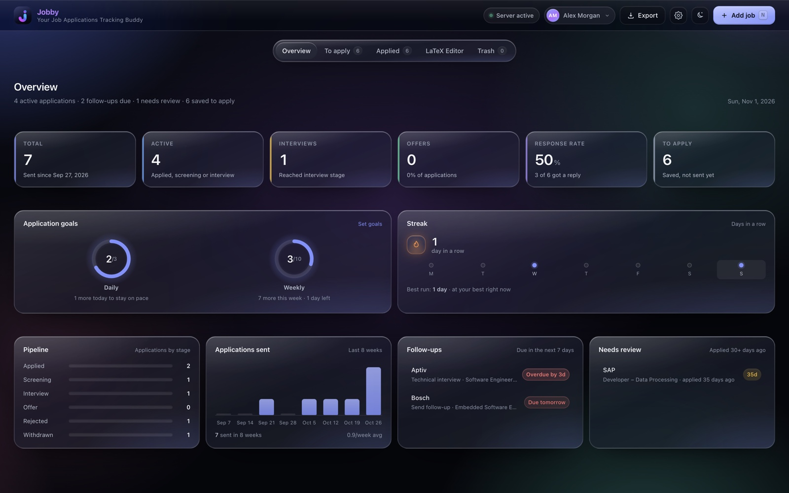
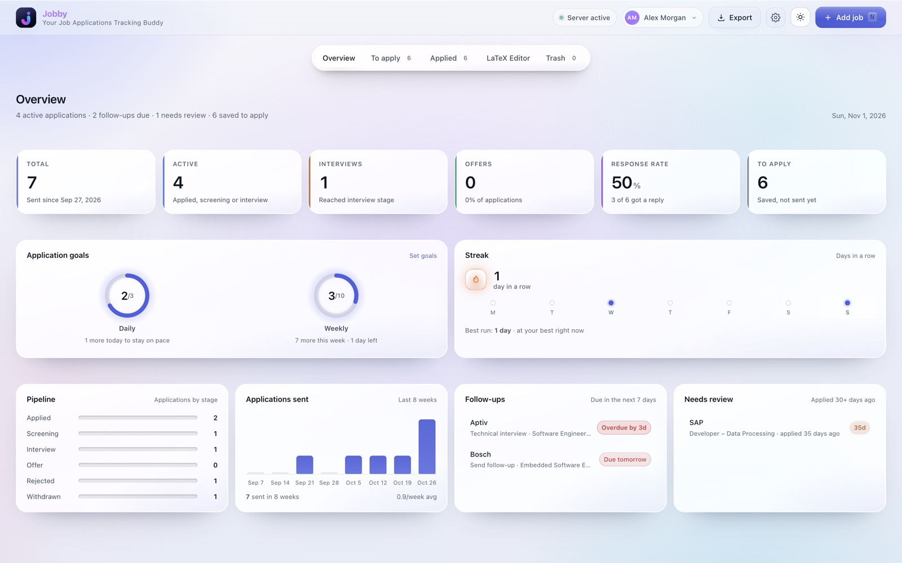
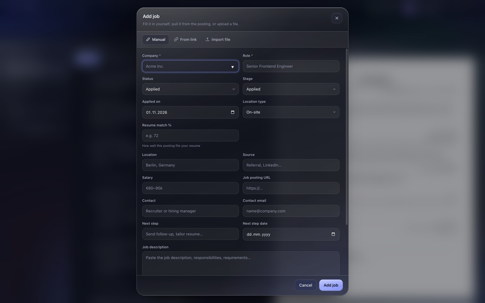
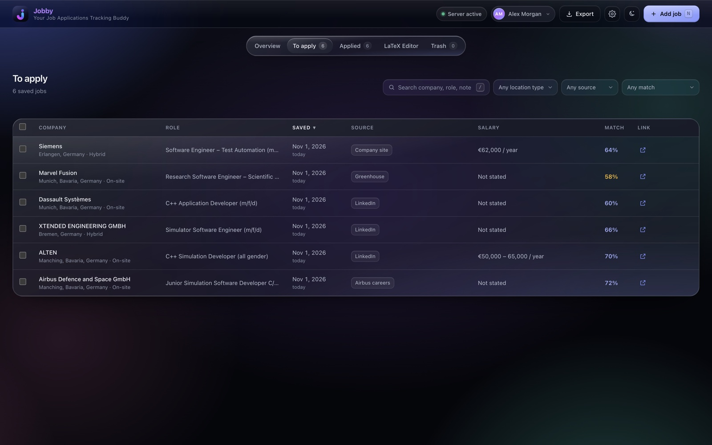
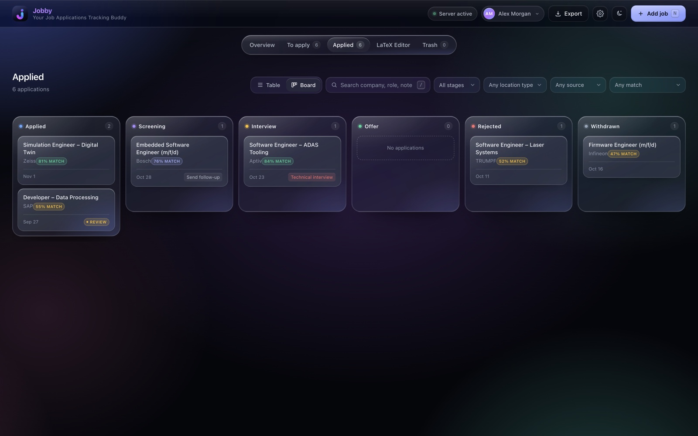
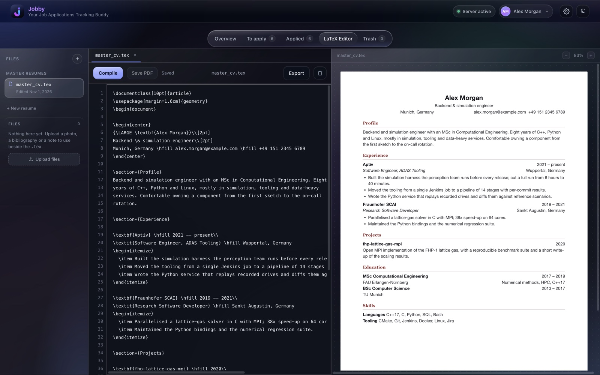
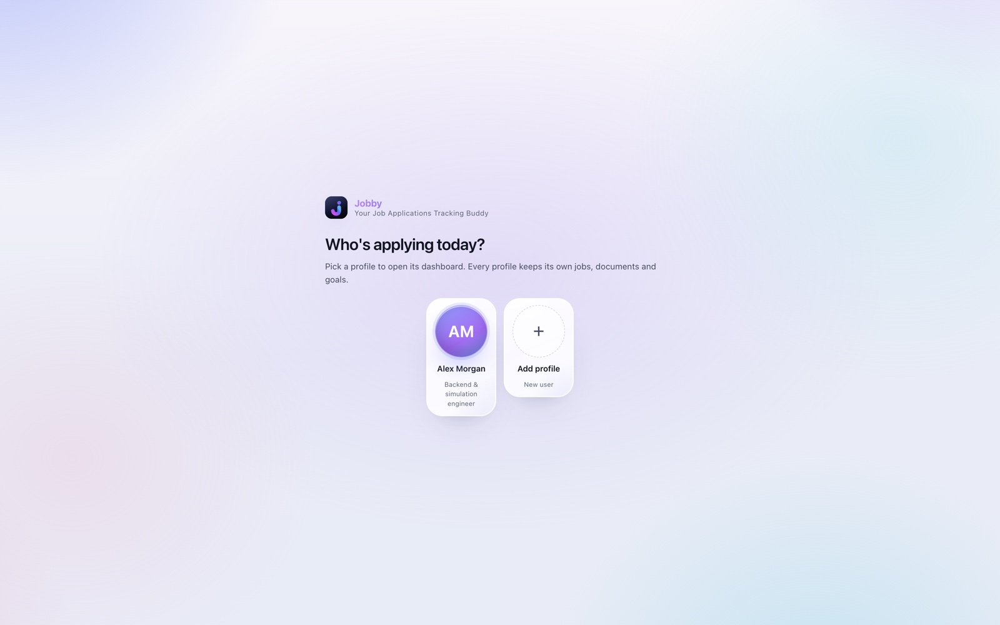
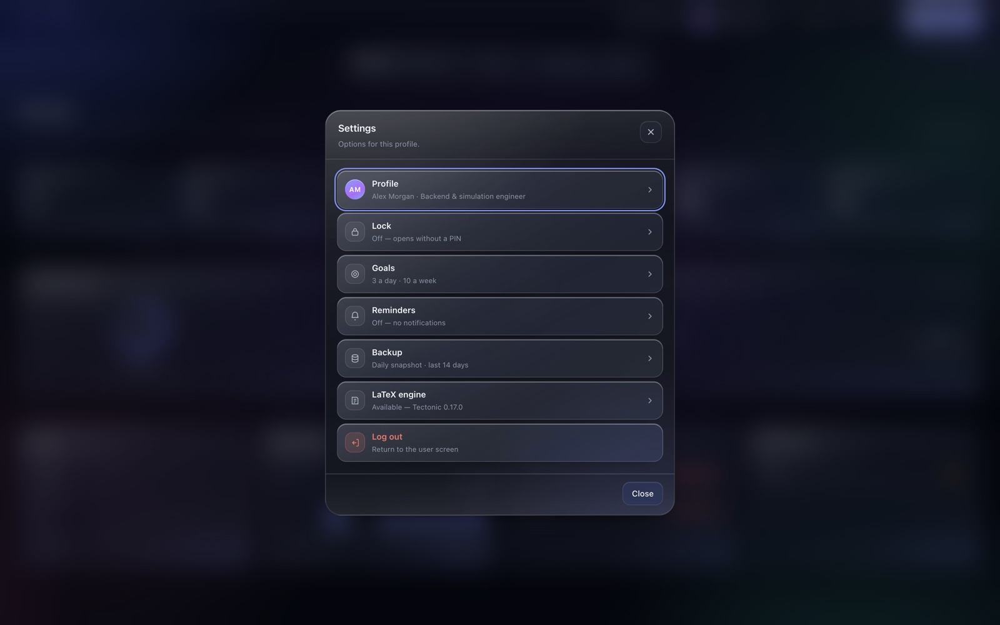

<div align="center">


# Jobby

**Your Job Applications Tracking Buddy**

A private dashboard for a job search, running entirely on your own machine:
one pipeline view, a list of jobs still to apply to, a sortable table and
drag-and-drop board for what you have sent, documents attached per job, and a
LaTeX resume editor that compiles a real PDF.

No account. No cloud. No build step.

[](https://github.com/janaarundinesh/Jobby/actions/workflows/tests.yml)


</div>



## Contents

- [Why Jobby](#why-jobby)
- [Quick start](#quick-start)
- [Your first five minutes](#your-first-five-minutes)
- [The screens](#the-screens)
  - [Overview](#overview) · [Adding a job](#adding-a-job) · [To apply](#to-apply) · [Applied](#applied)
  - [The job drawer](#the-job-drawer) · [The LaTeX editor](#the-latex-editor) · [Profiles and the PIN](#profiles-and-the-pin) · [Settings](#settings) · [Trash](#trash)
- [Reference](#reference)
  - [Search, filters and sorting](#search-filters-and-sorting) · [Import format](#import-format) · [Duplicates](#duplicates) · [Resume match](#resume-match)
  - [Follow-ups, goals and streak](#follow-ups-goals-and-streak) · [Needs review](#needs-review) · [Keyboard and screen readers](#keyboard-and-screen-readers) · [Look and feel](#look-and-feel)
- [Data, backups and privacy](#data-backups-and-privacy)
- [If the server stops](#if-the-server-stops)
- [Which icon to use](#which-icon-to-use)
- [Install it as an app](#install-it-as-an-app)
- [Command line](#command-line)
- [HTTP API](#http-api)
- [Development](#development)
- [Project layout](#project-layout)
- [Troubleshooting](#troubleshooting)

## Why Jobby

- **Nothing leaves the machine.** The data is a SQLite file in this folder and the files are in `data/uploads/`. No account, no sync, no analytics.
- **One place for the whole pipeline.** Jobs you have not applied to yet are kept apart from the ones you have, and each application carries its stage, dates, contacts, documents and a timeline.
- **A resume editor, not a folder of PDFs.** Write LaTeX with a live preview, compile it with Tectonic when you want the real file, and save the PDF straight onto a job.
- **Built for the boring middle of a search.** Daily and weekly targets, a streak, follow-ups due, and a monthly nudge to check whether a posting still exists.
- **Yours to run.** Python 3.8+ standard library only and plain ES modules in the browser: there is nothing to compile, bundle or update.

## Quick start

Jobby is a small Python server plus a web page. Double-clicking an app opens
both, so in practice there is nothing to install.

### macOS

1. Keep the project folder where it is and double-click **Jobby.app**.
2. The app starts the server, waits until it answers, and opens the dashboard in its own window.
3. Closing that window quits the app and stops the server a few seconds later.

> The bundle is a launcher: it compiles its dashboard window from the Swift source inside it on first launch. A machine without a Swift toolchain still gets the dashboard, in a browser tab.

### Windows

1. Double-click **Jobby.vbs** (beside `server.py`).
2. The server starts without a console window and the dashboard opens in its own window: Edge or Chrome in app mode, with the Jobby icon on the taskbar.
3. Closing that window stops the server a few seconds later.

> The script is read and run by Windows itself; there is nothing to compile. A machine without a Chromium browser still gets the dashboard in a normal browser window.

### From a terminal

```bash
python3 server.py            # http://127.0.0.1:8787
python3 server.py --open     # ...and open it in your browser
```

Stop it with `Ctrl+C`. The first run creates `data/tracker.db`, `data/uploads/`
and `data/backups/`.

**Optional: a real PDF.** The resume editor's **Compile** button uses
[Tectonic](https://tectonic-typesetting.github.io) when it is installed. The
launchers fetch it once into `tools/tectonic/` on first start; to do it yourself:

```bash
python3 install_tectonic.py    # official release, no admin rights, nothing system-wide
brew install tectonic          # macOS, if you prefer Homebrew
```

Everything else works without it — **Compile** falls back to the in-app preview,
and **Settings → LaTeX engine** says which engine was found, or offers to install one.

### The other launchers

**Start Jobby.command** (macOS) and **Start Jobby.bat** (Windows) do the same
thing with the server's log visible in a terminal window, for when you want to
watch it or stop it by hand. Both restart the server if it dies under them, and
give up after three failures in a row instead of spinning.

## Your first five minutes

1. **Pick a profile.** The first screen shows one round avatar per profile. Click **Add profile** to name yours; a profile keeps its own jobs, documents, goals and PIN. See [Profiles](#profiles-and-the-pin).
2. **Add a job.** Press `N` or click **Add job**, then fill the form, paste a posting link, or drop a `.csv`/`.json` file. Choose *Saved — not applied yet* for something you are still working on.
3. **Open it.** Click the row to slide out the drawer: description, next step, notes and documents live there.
4. **Attach what you send.** Drag a resume, cover letter or any other file onto the **Documents** section, or use **From saved files** to reuse a PDF you already made.
5. **Mark it applied.** From **To apply**, use the row's arrow, or select several rows and use the bulk bar's **Mark as applied**. The job moves to **Applied**, today's date goes on it, and your goals and streak start counting.
6. **Set your targets.** **Settings → Goals** (or **Set goals** on the Overview) sets a daily and weekly number; the rings turn green when you hit them.

Keyboard: `N` new job, `/` search, `Esc` close, `Enter` open the focused row,
arrows move between tabs. The full list is [further down](#keyboard-and-screen-readers).

## The screens

The sections live on a floating island under the header: a capsule of glass on
its own row, centred on the window, in the same place on every screen. It holds
its position while the page scrolls, and the row behind it is click-through, so
only the pill is ever over the page.

### Overview



Six counters, then the panels that keep a search moving:

- **The counters answer two different questions.** *Total*, the goals, the streak and the weekly chart count **applications sent** — and keep counting them if the job is later rejected or deleted, because the send still happened. *Active*, *Offers* and *Response rate* describe the jobs still on the list.
- **Application goals** — a ring each for your daily and weekly target. Hitting one sets off a short confetti burst and a toast.
- **Streak** — consecutive days with at least one application. It holds from yesterday until you send something today, so a streak breaks only after a whole empty day. The flame burns brighter once a streak is alive.
- **Pipeline and Applications sent** — applications by stage, and the last eight weeks as bars.
- **Follow-ups** — anything with a next-step date in the next seven days, with red labels for *Due tomorrow*, *Due in 3d* and *Overdue by 2d*.
- **Needs review** — applications that have been in an active stage for 30 days or more.

### Adding a job



Click **Add job** (or press `N`). There are three ways in:

| Way in | What it does |
| --- | --- |
| **Manual** | Fill the form yourself and choose **Applied** or **Saved — not applied yet** under Status. |
| **From link** | Paste a posting URL and press **Fetch details**. The server reads the page's `schema.org JobPosting` JSON-LD (Greenhouse, Lever, Workable, many career sites) and falls back to OpenGraph metadata, filling company, role, location, work mode, salary, source, description and the URL for you to review. |
| **Import file** | Drop or choose a `.csv` or `.json` file. Rows are checked against your list first. |

Nothing is saved without your confirmation. Only public `http(s)` addresses are
fetched — private and loopback addresses are refused — and sites that block
automated requests (LinkedIn, many Workday boards) give a clear error so you can
switch to manual entry.

**Fetching a link is a convenience, not a browser.** Pages that render their
posting with JavaScript return only what is in the HTML, so check the fields
before saving.

### To apply



Jobs you saved but have not sent. The same table as *Applied* — search, filters,
sort, links and match — minus the stage column, with a one-click **Mark as
applied** on every row.

Saved jobs are deliberately out of the pipeline: they do not count towards the
funnel, follow-up reminders, the streak or the board until you send them. That
is what makes it safe to keep twenty postings you are still deciding about.

### Applied



Everything you have actually sent, in either of two views:

- **Table** — search, filter, sort, change a stage inline, open the drawer, delete, and [bulk actions](#applied-bulk-actions).
- **Board** — one column per stage. Drag a card from *Applied* to *Screening*, *Interview* or *Offer*, or into *Rejected* / *Withdrawn*.

#### Applied bulk actions

Tick the checkbox on several rows (or the header checkbox for everything
currently shown) and a bar appears:

- **Delete** asks once, then moves the selection to Trash, where it can be restored.
- **Change stage… → Set stage** moves the whole selection to Screening, Interview, Offer, Rejected or Withdrawn at once. On *To apply*, the bar offers **Mark as applied** instead, which sends the selection to Applied with today's date.
- **Undo** in the message puts every job back where it was for a few seconds.

The selection clears when you change tabs. The bulk bar and every confirmation
use the same liquid-glass material as the rest of the app.

#### Rejecting a job

A rejection is part of the history, not a reason to lose the job: moving an
application to **Rejected** keeps it in Applied with its notes and timeline. If
it has files attached, one question follows — *Delete the files for this
application?* — naming them, with **Delete files** and **Keep files**. A job with
nothing attached is not asked about at all.

### The job drawer


Click any row or card. The drawer holds the whole application:

| Section | What you do there |
| --- | --- |
| **Stage** | Change it, or set a next step and its date. |
| **Details** | Applied on, resume match, location type, source, salary, contact, posting link. |
| **Job description** | The posting's text, kept with the job so it is there after the advert goes down. |
| **Documents** | Resume, cover letter and other files — see below. |
| **Personal notes** | Anything you want to remember; the search box reads them. |
| **Timeline** | Every stage change, oldest first. |

#### Documents

Attach a **resume**, a **cover letter** or any **other** file. You can also drag
files straight onto the section: drop one on a button to file it as that type,
or drop anywhere in the box to attach several at once, with the type guessed
from the file name. Files live in `data/uploads/<job id>/`; the limit is 10 MB
per file, and deleting a job deletes its files.

If that slot already holds a document, the dialog asks what to do: **Replace**
deletes the old one and its file as the new one goes in, **Keep both** attaches
the new file alongside it, or **Cancel** drops the upload.

**Preview without downloading.** Click a document name to open it in the same
preview sheet the resume editor uses: PDFs in the browser's viewer, images
inline, plain text, CSV and Markdown as text, with **Download** and **Open in
tab**. Word documents and other formats browsers cannot render show a short
notice instead. The bytes are fetched with your session token, so previews work
on a PIN-protected profile too.

### The LaTeX editor



Three panes, laid out like Overleaf: a rail of resume files, the LaTeX source
with line numbers, and the rendered page. It belongs to the profile, so each
person keeps their own.

- **Source** — a plain textarea over the `.tex` file, so what you see is what Overleaf compiles. `Tab` inserts two spaces, `Ctrl`/`Cmd`+`S` saves at once, and everything else saves about a second after you stop typing (the bar shows *Saved 14:32*).
- **Preview** — rendered as you type, with no TeX installation. It understands what resumes actually use: `\section`, `itemize`/`enumerate`, `\textbf`, `\href`, `\hfill` right-aligned dates, `center`, simple `tabular`, sizes such as `{\Large Name}`, and images. Unknown macros are dropped but their arguments are kept.
- **Problems** — the strip under the source names unbalanced braces or an environment that is never closed, with the line, instead of quietly producing a broken page.
- **Compile** — when Tectonic is available, runs it on the saved source and shows the real PDF in the preview pane. Support files are placed beside the `.tex` first, so `\includegraphics{profile.png}` resolves as it does in Overleaf. Compiling is sandboxed (`--untrusted`), limited to 60 seconds, and keeps the log. Without an engine, or when TeX refuses the source, the editor falls back to the in-app preview and puts the engine's log under the source.
- **Save PDF** — *Compile* only shows the PDF; **Save PDF** keeps it. One dialog takes the file name and the job it is for, then attaches it as **Resume**, **Cover letter** or **Other** in the same step. Each job in the list says what it already holds, and if the slot is taken the dialog offers **Replace it instead of adding a second copy**. **Just save** keeps the PDF with the resume without attaching it. Compiling on its own never writes a file.
- **Files** — upload a photo, a bibliography or a note beside the `.tex`; reference an image from the source and it renders in place. They are stored in `data/uploads/resume-<id>/` and deleted with the resume.
- **Master and tailored resumes** — **Start from a template** writes a starter resume from your profile that already renders. Your general versions are masters; every job's drawer has a **Resume** button that makes a tailored copy from your newest master — source and support files — and opens it.

> The live preview approximates LaTeX rather than running TeX, so fonts, spacing and page breaks differ from a compiled PDF. Check anything you actually send with **Compile** or in Overleaf.

### Profiles and the PIN



Each profile has its own jobs, trash, documents, goals and resumes; nothing is
shared between them.

- **The picker comes first.** A new browser session shows one round avatar per profile with what it says about itself, and a padlock when it has a PIN. It deliberately shows no job count: the screen is a door. Click an avatar to open that profile; the plus circle adds someone new.
- **Switching** — the profile button in the header opens the same list as a dialog, with the active profile tagged *Current*.
- **Deleting a profile** happens only inside that profile: **Settings → Delete this profile…**, with a confirmation naming how many jobs and files go with it. The API refuses it from anywhere else, and at least one profile always remains.
- **PIN lock** — a 4–8 digit PIN set in **Settings → Lock**. The lock is enforced by the server: a locked profile's jobs, documents, goals and trash answer `423 Locked` until a valid unlock token is presented. The token lives in memory and in that tab only, lasts 12 hours, and is gone on restart. The PIN is stored as a salted PBKDF2-SHA256 hash. Five wrong PINs are free; after that each miss makes the next answer wait longer — 30 seconds, doubling up to 15 minutes — and the message says how long, because a four-digit PIN is otherwise ten thousand quick guesses. A correct PIN, a new PIN or a restart clears the wait.

> The PIN guards the dashboard and its API, **not** the database file. Anyone who can read `data/tracker.db` can read the jobs without it.

### Settings



The gear in the header opens one menu for the current profile. Each option opens
its own panel with a back arrow, and `Esc` returns to the menu before closing.

| Panel | What it sets |
| --- | --- |
| **Profile** | Name, headline, email, phone, location and links — used by the resume template and shown in the picker. **Delete this profile…** lives here. |
| **Lock** | The PIN: set, change or remove, each asking for the current one. |
| **Goals** | The daily and weekly application targets. |
| **Reminders** | One daily notification summarising what is due. |
| **Backup** | A zip of the database and every document. |
| **LaTeX engine** | Whether **Compile** can build a PDF, which engine it found, and a one-click **Install Tectonic**. |
| **Log out** | Ends the session and returns to the picker. |

### Trash

Every delete asks first and moves the job to **Trash** with its timeline and
files intact. From there:

- **Restore** puts it back in Applied or To apply exactly as it was.
- **Delete forever** asks a second time, then removes the database rows and every attached file.
- **Empty trash** clears the whole bin after one confirmation, and is disabled while the bin is empty.

Nothing is emptied automatically.

## Reference

### Search, filters and sorting

- **Search** reads company, role, location, source, description and notes. `/` focuses it.
- **Filters** narrow by stage, location type, source and resume match. Stage matters only for Applied; the rest apply on every tab and to the board as well as the table.
- **Sorting** — click a table header, or focus it and press `Enter`. Dates sort newest first and **Match** sorts highest first, so one click shows your best-fitting saved jobs at the top. Jobs with no estimate always sit at the bottom rather than pretending to be a 0% match; the sorted column reports `aria-sort`.
- **The link column** holds one small icon button per row — a box with an arrow leaving it — instead of a wall of URLs, hovering to say *Open position* and where it goes. A job with no link shows `—`. A value that is not a web address stays visible as saved, dim and unlinked, rather than becoming a link that goes nowhere.
- **Long values are clipped, not left to push the table around.** An aggregator's source line or tracking URL is shortened to one line in the table, and trimmed to the app's limit when imported, so the Match column is never pushed off screen. Below 1100 px the Source and Salary columns step aside; from 1440 px the tables switch to fixed columns so the compact ones keep their width and the text columns share the rest.

### Import format

CSV headers are matched loosely: `position`/`title` → role, `date applied` → applied_on, `company name` → company, `job description` → description, `estimated match pct` → match_pct. Only **company** and **role** are required.

```csv
Company,Role,Phase,Status,Applied On,Location,Work Mode,Source,Salary,Match %,Job URL,Next Step,Next Step Date,Contact,Email,Description,Notes
"Acme, Inc.",Senior Frontend Engineer,Applied,Applied,2026-10-20,Berlin,Hybrid,Referral,€90–110k,84,https://acme.com/jobs/1,Send follow-up,2026-10-27,Marta Klein,marta@acme.com,"Own our design system","Referred by Priya"
"Globex",Staff Engineer,To apply,,2026-10-24,Remote,Remote,Company site,€120k,65,https://globex.com/jobs/2,Tailor resume,2026-10-26,,,,"Met at a meetup"
```

- `Phase` accepts `Applied` or `To apply` (also saved / wishlist / backlog / not applied).
- Statuses are normalized (`phone screen` → screening, `offer` → offer, `rejected`/`declined` → rejected), as are work modes and dates (`YYYY-MM-DD`, `MM/DD/YYYY`, `DD/MM/YYYY` when the first number is over 12).
- **A row with no status and no phase was never sent**, so it lands in *To apply* with no applied date. Name a stage (even `Rejected`) when the file really does describe applications you made.
- JSON accepts an array of objects or `{ "applications": [ … ] }` with the same aliases.
- **A file from a job-search tool carries more than the posting.** `estimated_match_pct` becomes the job's **Resume match**, and `why_it_matches` / `important_missing_requirements` are written into its **notes** under those headings. `match`, `match_percentage`, `match_score` and `resume_match` also count as the match; `missing_requirements` and `gaps` as the gaps. Anything else (`rank`, `employment_type`, …) is ignored.
- A row that cannot be used — no company or no role — is named in the import message with the reason, instead of a bare count.

**A complete example** — [`docs/examples/jobs.example.json`](docs/examples/jobs.example.json) is a real file that imports unchanged through **Add job → Import** (6 rows, none skipped). Taken row by row, it is the whole format in miniature:

| Row | What it demonstrates |
| --- | --- |
| 1 | The minimum — company and role, no stage — which lands in *To apply* |
| 2 | A saved posting with `match_pct`, a description, and `why_it_matches` / `important_missing_requirements` arriving in the notes |
| 3 | An application with a date, a contact, a follow-up date and a salary |
| 4 | A later stage (`interview`) with its next step |
| 5 | `status` alone naming a rejection, so the row counts as an application you made |
| 6 | Alias headers (`employer`, `position`, `link`, `date_applied`, `estimated_match_pct`) and a `DD.MM.YYYY` date |

Copy it, replace the postings with your own, and import the result — nothing else in it needs to change.

### Duplicates

A job is the same posting when its **company and role** match, ignoring case and
extra spaces. Adding one you already have — by hand, from a link or in a file —
opens a dialog naming the job that exists, with **Open job**, **Add anyway** or
**Cancel**. Imports check the whole file against your list and against the rows
before it, and offer **Skip them** or **Import anyway** before writing anything.
Jobs in the Trash do not count, so a posting you threw away can be added again,
and two different roles at one company are two jobs.

### Resume match

A job can carry an estimate of how well the posting fits your resume, as a whole
number from 0 to 100 — imported, or typed into **Resume match %** when adding or
editing. It has a sortable **Match** column in both tables, a chip on board cards
and a row in the drawer. Every number is coloured by its band: **80% and above**
green, **60–79%** indigo, **40–59%** amber, **below 40%** red — the same cuts as
the filter, so a number and the band that hides it always agree. An empty field
means no estimate, and the number is never invented or recomputed.

The estimate is whatever you or your tooling put there: Jobby stores and sorts
it, it does not score your resume.

### Follow-ups, goals and streak

- **Follow-ups** — any Applied job with a next-step date in the next seven days appears on the Overview, with red *Due tomorrow* / *Due in 3d* / *Overdue by 2d* labels, the same labels in the drawer and on board cards.
- **Goals** — daily and weekly targets, stored per profile. The week runs Monday to Sunday. **Set goals** in the panel goes straight to the goals field; the gear opens the whole settings menu.
- **Sends, not jobs.** The rings count applications sent, recorded on the server as they happen. Rejecting, deleting or moving a job does not take an application back off the day it went out. Correcting a job's **Applied on** date moves its send to the corrected day, and moving a job back to **To apply** says it was never sent.
- **Streak** — consecutive days with at least one send, holding from yesterday until you send something today, with the best run ever kept alongside.

Both the flame and the confetti respect `prefers-reduced-motion`.

### Needs review

Once an application reaches **30 days** in an active stage (Applied, Screening,
Interview) it is flagged: a **Review** badge in the table and on its card, and a
place in the Overview's **Needs review** panel. Open it and choose **Still open**
to record the check, or **No longer open** to close it as rejected. A reviewed
job becomes due again after another 30 days, so long processes get checked
monthly. Rejected, withdrawn and offered jobs — and jobs still in To apply — are
never flagged.

### Keyboard and screen readers

| Key | Action |
| --- | --- |
| `N` | Add a job |
| `/` | Focus the search box |
| `Enter` | Open the focused row |
| `Esc` | Close the dialog or drawer |
| `↑` `↓` `←` `→` | Move between tabs |
| `Tab` / `Shift`+`Tab` | Stay inside an open dialog |
| `Ctrl`/`Cmd`+`S` | Save the resume immediately |

Dialogs are labelled, the page behind an open dialog is `inert`, focus returns
to the button that opened it, and toasts are announced politely.

### Look and feel

The dashboard is one material in the spirit of Apple's Liquid Glass: a tinted
pane that blurs, saturates and lifts the colour drifting behind it, a lens that
catches the light along its top-left edge and picks up the accent at its
bottom-right, and a bevel of inset highlights instead of a flat border. It comes
in three densities — panes, detached surfaces (drawer, dialogs, menus), and a
nearly solid tier for anything read at length, so notes and LaTeX source never
compete with the glass behind them.

Both themes are glass — dark smoked and light frosted — and the header toggle
remembers your choice. Fills and text tones are tuned so body text clears 4.5:1
against the busiest part of the backdrop in either theme.

Everything is driven by custom properties at the top of
[`public/styles.css`](public/styles.css):

| Token | What it controls |
| --- | --- |
| `--lg-fill`, `--lg-fill-strong`, `--lg-fill-soft` | The three densities: a pane, a detached surface, a card lying on a pane |
| `--lg-lens` | The lens: top-left highlight, accent bloom at the bottom-right, diagonal sheen |
| `--lg-rim`, `--lg-edge`, `--lg-edge-top`, `--lg-edge-bottom` | The bevel and its hairlines |
| `--lg-blur`, `--lg-sat`, `--lg-bright` | How hard the material blurs, boosts colour and lifts brightness |
| `--lg-lift`, `--lg-text-shadow`, `--lg-radius` | The float shadow, the faint shadow under big numerals (dark theme only), the corner radius |
| `--glow-1` … `--glow-4` | The colour fields drifting behind everything |

The backdrop drift, the hover glints, the flame and the confetti all respect
`prefers-reduced-motion`, and a browser without `backdrop-filter` still gets
readable translucent tints instead of flat colour.

### Data, backups and privacy

| Where | What |
| --- | --- |
| `data/tracker.db` | The database (SQLite, WAL mode): jobs, stages, notes, profiles, goals, resumes. |
| `data/uploads/<job id>/` | A job's documents. |
| `data/uploads/resume-<id>/` | A resume's support files. |
| `data/backups/` | The newest 14 daily snapshots, `tracker-YYYY-MM-DD.db`. |
| `data/server.log` | The server's log, rotated to `server.log.1` past 2 MB. |

- **Automatic snapshots** — the first start each day copies the database with SQLite's own backup, so the copy is consistent while the app is open.
- **Download a backup** — **Settings → Backup → Download backup (.zip)** saves the database together with every uploaded document and resume file, built from a fresh snapshot.
- **Export** — **Export ▾** writes every job as JSON or CSV, including phase, description, notes and the match.
- **Nothing is uploaded.** The only network traffic the app makes on its own is fetching a posting you paste, and downloading Tectonic if you ask for it.
- **The local API is fenced in.** Every call must carry a loopback `Host` header (DNS rebinding), writes must come from the same origin (no cross-site posts), and every call except the health probe needs the session token from `/api/session`, which only the dashboard's origin can read. A locked profile additionally needs its unlock token, and its files are fetched with signed requests rather than plain URLs.

## If the server stops

Every screen is served by one Python process, so the dashboard is only as alive
as it is. Four things keep that visible and fixable:

- **The pill in the header** reads `GET /api/health` every 20 seconds, turns red the moment a request cannot reach the server, and goes green as soon as one gets through. Its tooltip names the address it watches.
- **Retry** appears while it is red and checks there and then, backing off from 2 seconds to 20 until the server answers. After a long outage, coming back offers **Reload**, because the lists may be stale.
- **The launchers** start a server that is not running (`Jobby.app`, `Jobby.vbs`) and restart one that died under them (`Start Jobby.command`, `Start Jobby.bat`).
- **Closing the dashboard** stops the server the app started, about two minutes after the last request it answered.

A page in a browser cannot start a program on your computer — that is the limit
to know about. Retry only ever checks; starting the server happens in a launcher.

## Which icon to use

| Icon | Can start the server? |
| --- | --- |
| **Jobby.app** (macOS, in the project folder) | Yes. Double-click it or drag it to the Dock; keep the bundle where it is, or dock an alias, so it can find your data. |
| **Jobby.vbs** (Windows, in the project folder) | Yes. Double-click it or pin it to the taskbar; keep it beside `server.py`. |
| **The browser's install** (*Add to Dock*, *Install page as app*) | No. It is a web page, so while the server is down it can only show the start screen. |

## Install it as an app

A [web app manifest](public/manifest.webmanifest) and a [service worker](public/sw.js)
let the dashboard run in its own window without browser tabs — useful for a
machine where you would rather not use the bundled app.

- **Chrome, Edge, Brave** — the install icon in the address bar, or ⋮ → *Cast, save and share* → *Install page as app*.
- **Safari on macOS 14+** — **File → Add to Dock**. On iPhone or iPad, **Share → Add to Home Screen**.

The worker caches the shell (`index.html`, `styles.css`, the modules, the icons),
so an installed window still opens when the server is stopped and shows the start
screen with **Check again**, which keeps looking and steps into the dashboard on
its own. Job data, settings and documents are **never** cached: every API call
goes straight to the server. While the server runs, a reload always fetches the
current files, so upgrades take effect immediately.

## Command line

```bash
python3 server.py --port 8080 --open
```

| Flag | Default | What it does |
| --- | --- | --- |
| `--port` | `8787` | Port to listen on |
| `--host` | `127.0.0.1` | Bind address (keep it on loopback for local-only use) |
| `--db` | `data/tracker.db` | SQLite database file |
| `--open` | off | Open the dashboard in your default browser |
| `--exit-when-idle` | off | Stop once no request has arrived for `SECONDS`; the app passes `120` |

## HTTP API

Everything the dashboard does is a JSON call against the local server, so you
can script it. Every endpoint except `/api/profiles`, `/api/session`,
`/api/backup` and `/api/health` works on one profile: send `X-Profile-Id: <id>`
to pick it (without the header the first profile is used). For a PIN-protected
profile also send `X-Profile-Token` with the token from `/unlock`, otherwise the
data endpoints answer `423`.

```
GET    /api/applications                      list all jobs
GET    /api/applications/<id>                 one job + status events + documents
POST   /api/applications                      create; answers 409 with {"matches": [...]} when that
                                              company and role are already on the list, unless
                                              {"force": true} adds a second copy
PATCH  /api/applications/<id>                 partial update (phase, status, description, match_pct, …);
                                              match_pct is 0–100, "" clears it
                                              { "mark_reviewed": true } records a review
DELETE /api/applications/<id>                 move job to trash (soft delete)
DELETE /api/applications/<id>?permanent=1     permanently delete a trashed job + files
POST   /api/applications/<id>/restore         restore a trashed job
GET    /api/applications?trash=1              list trashed jobs
DELETE /api/trash                             permanently delete every trashed job and its files
POST   /api/applications/<id>/documents       upload { filename, kind, content_type, data (base64) };
                                              "replace": true removes that job's documents of
                                              the same kind (and their files) first
GET    /api/applications/<id>/documents/<doc> download a document
GET    /api/applications/<id>/documents/<doc>?inline=1  preview a PDF, image or text file inline
DELETE /api/applications/<id>/documents/<doc> remove a document
GET    /api/resumes                            resumes with their file counts
POST   /api/resumes                            { "name": "master.tex" } starts from a template,
                                              { "application_id": 1 } makes a tailored copy of the master
GET    /api/resumes/<id>                       one resume with its source and files
PATCH  /api/resumes/<id>                       { "source", "name", "label" }
DELETE /api/resumes/<id>                       remove the resume and its files
POST   /api/resumes/<id>/files                 upload { filename, content_type, data (base64) } —
                                              this is also how the LaTeX Editor's Save PDF keeps a
                                              compiled PDF under the name you choose
GET    /api/resumes/<id>/files/<file>          open a support file (images inline)
DELETE /api/resumes/<id>/files/<file>          remove a support file
GET    /api/files                              every file saved with your resumes, newest first,
                                              with the resume (and job) it belongs to
GET    /api/documents                          what each job already has attached, keyed by job
                                              id — the Save PDF dialog's summary line
POST   /api/files/<file>/attach                { "application_id": 1, "kind": "resume" } copies a
                                              saved file onto a job's documents; add
                                              "replace": true to remove that job's documents
                                              of the same kind (and their files) first — the
                                              response lists the ids it replaced
GET    /api/engine                             whether Compile can build a PDF, with the engine's
                                              name and path, and the state of any install
POST   /api/engine/install                     fetch Tectonic into tools/tectonic/ in the background;
                                              poll GET /api/engine until it is ready or failed
GET    /api/settings                           daily and weekly application goals
PATCH  /api/settings                           update goals, e.g. { "daily_goal": 5, "weekly_goal": 20 }
GET    /api/profiles                           every profile with its job counts and locked flag
POST   /api/profiles                           create a profile, { "name": "Freelance", … }
GET    /api/profiles/<id>                      one profile
PATCH  /api/profiles/<id>                      update name, headline, email, phone, location, links
DELETE /api/profiles/<id>                      remove the profile with its jobs, files and goals;
                                              only from inside that profile (X-Profile-Id must match)
POST   /api/profiles/<id>/pin                  { "pin": "1234" } sets or changes it (needs current_pin
                                              once set); { "remove": true, "current_pin": "…" } clears it
POST   /api/profiles/<id>/unlock               { "pin": "1234" } → { "token": "…" }
POST   /api/profiles/<id>/lock                 revoke every unlock token for the profile
POST   /api/import                            { "applications": [ … ] }; rows matching an existing
                                              job are skipped and listed under "duplicates",
                                              {"force": true} imports them anyway
POST   /api/extract                           { "url": "https://…" }
GET    /api/session                           { "token": "…" } for this run of the server
GET    /api/backup                            a zip of the database and every document
GET    /api/health                            open, no token needed
```

Send `X-Api-Token` from `/api/session` on every call, and an `Origin` matching
the server on writes:

```bash
BASE=http://127.0.0.1:8787
TOKEN=$(curl -s $BASE/api/session | python3 -c 'import json,sys; print(json.load(sys.stdin)["token"])')

curl -X POST $BASE/api/applications \
  -H "X-Api-Token: $TOKEN" \
  -H "Origin: $BASE" \
  -H 'Content-Type: application/json' \
  -d '{"company":"Acme","role":"Frontend Engineer","phase":"applied","status":"applied"}'
```

## Development

The API and browser suites run against the real HTTP server with a throwaway
database in a temp directory, so neither touches `data/`.

```bash
python3 -m pip install -r requirements-dev.txt
python3 -m playwright install chromium  # once, for the browser suite

python3 -m pytest -q                    # API suite
RUN_E2E=1 python3 -m pytest tests/e2e   # browser suite
```

- **API suite** — over a hundred tests: creating and validating jobs, stage changes and their timeline events, review marks, the trash flow, document upload and inline preview with byte ranges and content-type safety, goals, imports (including the to-apply default, the notes a file folds in and the match estimate), profiles and their isolation, the PIN lock, the wait after repeated misses and unlock tokens, resumes and tailored copies, the local-only guards (foreign `Origin`, missing token, foreign `Host`, the `Content-Security-Policy` the page is served with), and the daily backup and its pruning.
- **Browser suite** — drives Chromium with Playwright: the picker, adding a job and opening its drawer, the settings walk, goals, a real backup zip, one notification a day, the dialog focus trap and keyboard sorting, a locked profile's documents and `\includegraphics` picture, previews that cannot load offering **Try again**, match bands, links in the tables, the server pill turning red and green again, and the app installing and opening offline.
- **Launcher suite** — drives the launch scripts with stand-in tools: a crashing `python3` for the restart loop, a `swiftc` stub for the window build, and `cscript` for the Windows script in CI.

GitHub Actions runs the API suite, the Windows launcher job and the browser job
on every push to `main` and on pull requests, via
[.github/workflows/tests.yml](.github/workflows/tests.yml).

### Pre-commit hook

```bash
git config core.hooksPath .githooks
```

The hook runs the API suite before every commit and aborts on failure. It uses
`$JOBPIPE_PYTHON` if set, otherwise `.venv/bin/python`, `venv/bin/python`, then
`python3`; if that interpreter has no pytest it says so and lets the commit
through rather than blocking on a missing tool.

```bash
python3 -m venv .venv
.venv/bin/pip install -r requirements-dev.txt
```

## Project layout

```
Jobby.app/              macOS app bundle: starts the server if needed, then opens the dashboard
  Contents/MacOS/Jobby    the launcher: server, then the window (or a browser tab)
  Contents/Resources/JobbyWindow.swift
                          the dashboard window (WKWebView), compiled on first launch
  Contents/Resources/JobbyServer.app
                          invisible helper app that runs the server so it outlives Jobby.app
Jobby.vbs               Windows app: starts the server unseen, opens the dashboard in its own window
Start Jobby.command     macOS double-click launcher (same thing, in a terminal window)
Start Jobby.bat         Windows double-click launcher (the same window, with a visible console)
server.py               HTTP server, JSON API, validation, SQLite schema, document storage
extract.py              Job posting extraction (JSON-LD + OpenGraph, stdlib only)
public/                 Dashboard UI: index.html, styles.css, sw.js, manifest, icons
  js/                   main.js (events and boot), core.js (state, dates, API client),
                        data.js (loading and mutations), overview.js, workspace.js,
                        drawer.js, dialogs.js, profiles.js (picker, PIN, settings),
                        io.js (import/export), resume.js (editor and LaTeX preview),
                        a11y.js (dialog focus), reminders.js, pwa.js, status.js
docs/screenshots/       The images in this README
docs/examples/          jobs.example.json, a file the Import dialog accepts as it is
docs/social-preview.png 1280x640 card GitHub shows when the repository is shared
tests/                  pytest suite for the API
  tests/e2e/            Playwright suite driving the dashboard in Chromium
data/                   Created on first run: tracker.db, uploads/ and backups/
.githooks/              pre-commit hook that runs the suite
.github/                CI workflows that run all three suites
requirements-dev.txt    pytest and Playwright, only needed for the tests
```

## Troubleshooting

| Symptom | What is happening | What to do |
| --- | --- | --- |
| The dashboard shows **Start the Jobby server** | The page loaded, the server did not answer. A web page cannot start a process. | Double-click **Jobby.app** (macOS) or **Jobby.vbs** (Windows), or run `python3 server.py`. **Check again** keeps looking and steps in by itself. |
| The header pill is red and **Retry** cannot fix it | The server is gone, not slow. | Start it with a launcher. Retry only checks. |
| *Address already in use* in the log | Another process holds port 8787 — often a second copy of Jobby. | Quit the other one, or run `python3 server.py --port 8080`. |
| **Compile** shows the preview instead of a PDF | No LaTeX engine was found, or TeX refused the source. | **Settings → LaTeX engine** to install Tectonic, or run `python3 install_tectonic.py`. The engine's log appears under the source when TeX fails. |
| A preview says *This profile is locked* | The file was opened with a bare URL, which cannot carry the unlock token. | Open documents and resume files from inside the dashboard, where they are fetched with the session and unlock tokens. |
| Uploading a file does nothing | Files over 10 MB are refused. | Split the file or link it in the notes instead; the message names the file. |
| A job will not be added | Company and role already exist. | Use **Open job** in the dialog, **Add anyway** for a real second application, or check Trash. |
| The dashboard closed and the server kept running | It was started from a terminal, so it stays until `Ctrl+C`. | Close that window, or start it with a launcher next time. |
| Notifications never appear | Permission was not granted, or an installed window is not allowed to raise them. | **Settings → Reminders** asks once; where the page cannot, the service worker posts the notification instead. |

The screenshots use an invented profile and made-up applications, so no real
person's search is in this repository. The company names appear because postings
have company names; nothing in the images is a real application.

